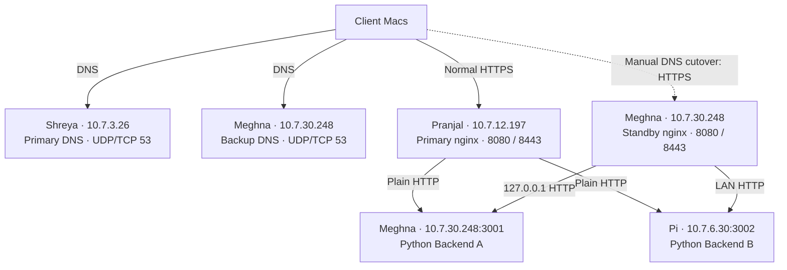

# Dracarys architecture - Phase 2

Deployment: 24 November 2026. This document supersedes the operational guidance in the [historical Phase 1 architecture](architecture-phase1.md); historical evidence and Git history are preserved. See [final report](phase2-report.md) for test outcomes and [configuration bundle](../configs/phase2/README.md) for reconstructed files.

## Physical hosts and service map

| Host | Phase 2 IPv4 | Interface | Services / role | Evidence |
|---|---|---|---|---|
| Shreya Mac | 10.7.3.26 | en0 (deployment configuration) | dnsmasq UDP/TCP 53, client | DNS answers, PCAP frames 1-2 |
| Pranjal Mac | 10.7.12.197 | en0 | nginx 1.31.6, TCP 8080/8443, client | E015, E020, E039 |
| Meghna Mac | 10.7.30.248 | en0 | Python A :3001, dnsmasq :53, temporary nginx 1.31.10 :8080/8443 | E001, E005, E007-E008 |
| Raspberry Pi | 10.7.6.30 | wlan0 | Python B :3002; SSH identity isro@isro-desktop | E023, E055 |

E023 confirms the Pi's /19 prefix. The historical network was 10.7.0.0/19 with gateway 10.7.0.1; do not present historical MAC addresses, gateways or all Mac prefixes as newly measured Phase 2 inventory. Re-record them with the runbook before evaluation. The actual hardware is three Macs and a Pi, a deviation from the assignment's suggested Mac-only layout; confirm faculty acceptance if not already agreed.

## Topology

DNS is a separate lookup, not a proxy hop for HTTPS packets. In normal state both resolvers return 10.7.12.197 for app (TTL 30); during migration both are edited to 10.7.30.248. api remains a DNS/HTTP alias, with no demonstrated HTTPS SAN coverage. The separate ttl record uses 120 seconds for cache experiments. Resolver records are synchronized manually.

## Request and protocol flow

1. The system resolver selects a configured team DNS server. A DNS A query uses UDP 53 in the supplied capture; TCP 53 is also a configured DNS service. E012 identifies Pranjal's Wi-Fi DNS list. E043 shows a scoped dracarys.test resolver on an unlabeled client, not proof of that machine's global Wi-Fi setting or owner.
2. The client connects to the returned edge IP on TCP 8443. Capture socket pair: 10.7.3.26:63203 ↔ 10.7.12.197:8443. SYN, SYN-ACK and ACK consume/acknowledge sequence space before TLS starts.
3. TLS negotiates with SNI app.dracarys.test. The client checks hostname, issuer chain and validity. Later curl outputs negotiate TLS 1.3 and ALPN http/1.1. The historical Phase 1 TLS 1.2 screenshots are a different session.
4. nginx terminates TLS, selects an upstream and forwards plain HTTP. Backends emit HTTP/1.0 responses; clients receive HTTP/1.1 from nginx. Upstream request version is separate from backend response version; the templates leave nginx's proxy version default unchanged rather than claiming a measured version for every hop.
5. A or B returns JSON, `X-Backend`, `Cache-Control: max-age=60` and ETag. nginx adds `X-Edge: primary` or `standby`, encrypts the client response and eventually closes TCP. Forwarded IP headers are set, but Python's default request logging still records the socket peer unless application logging is changed.

| Layer | Protocol | Meaning in this system |
|---|---|---|
| Application | DNS, HTTP | Name mapping; GET/HEAD, headers and status |
| Security between HTTP and TCP | TLS | Client-to-edge authentication, encryption and integrity |
| Transport | UDP / TCP | DNS datagrams; reliable ordered streams and ports |
| Network | IPv4 | Host addressing and routing |
| Link / physical | Wi-Fi/Ethernet, ARP | Local frames, neighbor resolution and physical transmission |

TLS does not fit exactly one OSI layer; it sits above TCP and below HTTP. Backend traffic is not encrypted end-to-end. See [frame analysis](packet-capture-analysis.md) for what is and is not visible in the PCAP.

## Failures and isolation boundaries

Primary nginx uses `max_fails=1 fail_timeout=10s`, connect timeout 2s, read/send timeouts 5s and up to two upstream tries on configured failures. This is passive detection during real requests, not an active health monitor. It produced ten observed B-only successes while A was stopped, then A/B recovery; it does not guarantee zero downtime for arbitrary failures or non-idempotent operations.

During isolation, PF on Meghna allowed the primary edge to A and dropped other IPv4 LAN access to :3001. Pi's DRACARYS_BACKEND chain allowed primary traffic on wlan0, returned loopback traffic, and dropped other traffic entering that chain for :3002. Existing Docker/Tailscale rules were background state. A future IPv6 backend listener would need a separate IPv6 policy; the supplied Python services bind IPv4.

The demonstrated firewall policy was removed afterward. Migration later served both backends from standby, but the firewall adjustment permitting standby-to-Pi is not recorded. Treat isolation and migration as distinct test stages; a combined policy must explicitly allow both edge sources. Do not call final state permanently isolated.

The primary edge remains a single point of failure until manual cutover. Meghna combines A, backup DNS and standby edge; its failure affects all three. Shared Wi-Fi/power, manual DNS edits and CA operational custody remain risks. Fully automatic edge HA would need failure detection and a coordinated address/traffic takeover mechanism; it is outside this deployment.

## Application and caching limits

The unchanged Python files provide GET/HEAD for `/` and `/api/status`, with backend identifiers, and a bare 404 for other paths. The default server is intentionally simple and single-threaded. HEAD does not provide every GET metadata field. A shared fixed strong ETag (`"dracarys-v1"`) is reused across different A/B and endpoint bodies, so historical 304 output demonstrates the conditional mechanism but not standards-complete cache correctness. A production repair would derive validators from representations or serve identical cacheable content; it would require new tests and fresh deployment evidence.

DNS TTL caches an address; HTTP max-age caches a representation. curl does not persist an automatic HTTP cache between invocations. HTTP/2 is not evidenced merely because curl offered h2; HTTP/3/QUIC and SMTP/IMAP/POP3 are explanation-only topics. Conceptually, dnsmasq resembles private managed DNS, nginx a reverse proxy/load balancer, and cache headers inputs to a browser/CDN cache; no cloud service or CDN is deployed.
